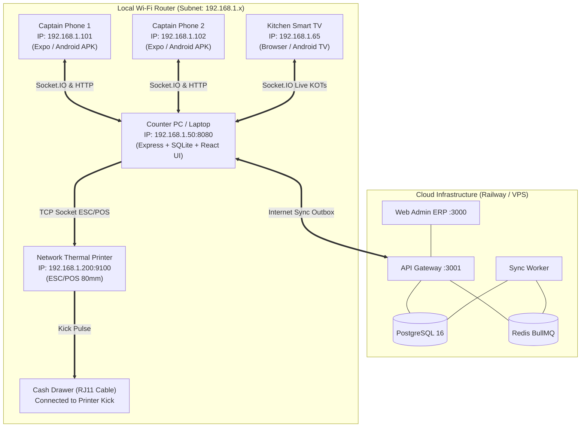

# 🍽️ Gusto ERP — Client Handover, Setup & Operational Run Guide

> **Version:** 1.0 (Dry-Run Release)  
> **Target Audience:** Client Technical Leads, Restaurant General Managers, Operations Staff, and IT Deployers  
> **Scope:** End-to-end setup instructions, network topology, working features inventory, mock data & stub transparency, and step-by-step test workflows.

---

## 📑 Table of Contents
1. [Executive Summary & Distribution Packages](#1-executive-summary--distribution-packages)
2. [Prerequisites & System Requirements](#2-prerequisites--system-requirements)
3. [Step-by-Step Setup & How to Run All Services](#3-step-by-step-setup--how-to-run-all-services)
   - [Package 1: Gusto POS Desktop & Local Server (`gusto-pos-desktop.zip`)](#package-1-gusto-pos-desktop--local-server-gusto-pos-desktopzip)
   - [Package 2: Gusto KDS Kitchen Display (`gusto-kds.zip`)](#package-2-gusto-kds-kitchen-display-gusto-kdszip)
   - [Package 3: Gusto Captain Waiter App (`gusto-captain.zip`)](#package-3-gusto-captain-waiter-app-gusto-captainzip)
   - [Package 4: Cloud ERP Services (Web Admin, API Gateway, Sync Worker)](#package-4-cloud-erp-services-web-admin-api-gateway-sync-worker)
4. [Restaurant LAN Network & Hardware Topology](#4-restaurant-lan-network--hardware-topology)
5. [Comprehensive Feature Inventory: Working & Production-Ready](#5-comprehensive-feature-inventory-working--production-ready)
6. [Transparency Report: Mock Data, Simulated Hardware & Stubs](#6-transparency-report-mock-data-simulated-hardware--stubs)
7. [Step-by-Step Client Dry Run Testing Walkthroughs](#7-step-by-step-client-dry-run-testing-walkthroughs)
8. [Master Credentials, Staff PINs & Keyboard Shortcuts](#8-master-credentials-staff-pins--keyboard-shortcuts)
9. [Troubleshooting & Frequently Asked Questions](#9-troubleshooting--frequently-asked-questions)

---

## 1. Executive Summary & Distribution Packages

Gusto ERP is engineered with a **local-first, cloud-synchronized architecture**. This ensures restaurant billing and kitchen operations never stall during internet outages, while management maintains cloud oversight across multiple outlets.

Clients receive **four self-contained packages**:

| Package / Archive | Form Factor | Primary Device | Contents & Role |
|---|---|---|---|
| **`gusto-pos-desktop.zip`** | Pre-compiled Node bundle + Embedded Static Web UIs | Cashier PC / Counter Laptop (Windows / macOS) | Single-click launcher containing the Express REST API, SQLite database, Socket.IO hub, POS Cashier Billing UI, and embedded KDS screen. |
| **`gusto-kds.zip`** | Web Application & Android TV Bundle | Kitchen Smart TV / Android TV / Tablet | Real-time Kitchen Order Ticket (KOT) display with prep timers, station filters, and chime alerts. |
| **`gusto-captain.zip`** | React Native Expo bundle & APK Builder | Waiter Smartphones (Android / iOS) | Floor captain order-taking app for table seating, modifiers, and instant KOT firing. |
| **`cloud-erp-services`** | Docker / Cloud Deployed (Railway / Render / VPS) | Cloud Server & Head Office Browsers | Web Admin ERP (Next.js 15), Fastify API Gateway, and BullMQ Redis Background Sync Worker. |

```
                       ┌──────────────────────────────────────────────┐
                       │          CLOUD MANAGEMENT (Cloud/VPS)        │
                       │  - Web Admin ERP (Port 3000)                 │
                       │  - API Gateway Fastify (Port 3001)           │
                       │  - Sync Worker BullMQ (Redis + PostgreSQL)   │
                       └──────────────────────┬───────────────────────┘
                                              ▲
                           Cloud Sync Push/Pull (REST & WebSockets)
                                              ▼
┌─────────────────────────────────────────────────────────────────────────────┐
│                       LOCAL RESTAURANT LAN (Wi-Fi / LAN)                    │
│                                                                             │
│  ┌─────────────────────────┐     Socket.IO     ┌─────────────────────────┐  │
│  │   📱 Gusto Captain      ├──────────────────►│   🖥️ Gusto POS Server    │  │
│  │   Waiter Smartphone     │                   │   (Port 8080)           │  │
│  └─────────────────────────┘                   │   - SQLite Database     │  │
│                                                │   - Thermal Print Engine│  │
│  ┌─────────────────────────┐     Socket.IO     │   - Cashier Web UI      │  │
│  │   📺 Gusto KDS TV       ├──────────────────►│   - Embedded KDS Web    │  │
│  │   Kitchen Display       │                   └────────────┬────────────┘  │
│  └─────────────────────────┘                                │               │
│                                                             ▼               │
│                                                🖨️ Thermal Receipt Printer   │
│                                                💵 Hardware Cash Drawer Kick │
└─────────────────────────────────────────────────────────────────────────────┘
```

---

## 2. Prerequisites & System Requirements

### For the Counter POS Machine (Windows / macOS / Linux)
- **Node.js:** v20.x or higher LTS installed ([Download Node.js](https://nodejs.org/)).
- **Memory (RAM):** 4 GB minimum (8 GB recommended).
- **Network:** Connected to the restaurant's local Wi-Fi router (LAN).
- **Operating System:** Windows 10/11, macOS 12+, or Ubuntu 20.04+.

### For Kitchen Display (KDS)
- Any Smart TV, Android TV, Fire TV Stick, iPad, or Android tablet with a modern web browser (Chrome, Firefox, Safari, or Silk).
- Must be connected to the same local Wi-Fi router as the Counter POS Machine.

### For Floor Waiters (Captain App)
- Any modern smartphone running **Android (v9.0+)** or **Apple iOS (v14.0+)**.
- Free **Expo Go** app installed (for instant zero-install dry run testing) OR the generated standalone `.apk`.

---

## 3. Step-by-Step Setup & How to Run All Services

### Package 1: Gusto POS Desktop & Local Server (`gusto-pos-desktop.zip`)

This package is the central nerve center for local restaurant operations. It runs the local server and hosts both the Cashier Billing UI and the Kitchen KDS UI.

#### Installation & Launch:
1. Extract `gusto-pos-desktop.zip` to your desired folder (e.g. `C:\GustoPOS` on Windows or `~/GustoPOS` on macOS).
2. Ensure Node.js is installed by opening a terminal/command prompt and typing `node -v`.
3. **Launch the POS Server:**
   - **On Windows:** Double-click `start-pos.bat`.
   - **On macOS / Linux:** Open Terminal in the extracted directory and run:
     ```bash
     chmod +x start-pos.sh
     ./start-pos.sh
     ```
4. **What happens automatically:**
   - The local Express server starts on port `8080`.
   - The pre-seeded SQLite database (`data/local.sqlite`) initializes.
   - Your default browser automatically opens to **`http://localhost:8080`** (POS Cashier Billing Counter).
   - The KDS Kitchen Display is simultaneously available at **`http://localhost:8080/kds`**.
5. **Staff Login:**
   - Select Cashier or Manager and enter PIN **`1234`**.

> [!TIP]
> **LAN Access for other Counter Laptops or Tablets:**  
> Any tablet or secondary counter PC connected to the same Wi-Fi can open the POS billing screen by typing `http://<POS_LOCAL_IP>:8080` into its browser (e.g. `http://192.168.1.50:8080`).

---

### Package 2: Gusto KDS Kitchen Display (`gusto-kds.zip`)

The Kitchen Display System requires **zero compilation** for web-capable smart screens.

#### Method A: Direct Browser on Smart TV / Tablet (Recommended)
1. Ensure the TV/Tablet is on the same Wi-Fi network as the POS machine.
2. Open the built-in browser (Chrome, Silk, Firefox) on the TV.
3. Navigate to:
   ```
   http://<POS_LOCAL_IP>:8080/kds
   ```
   *(Example: `http://192.168.1.50:8080/kds`)*
4. Press **F11** on your TV remote/keyboard or tap Fullscreen.
5. The screen stays awake, connects via Socket.IO, and chimes when orders are fired.

#### Method B: Standalone Web Runner
If you prefer running the KDS standalone from `dist-packages/gusto-kds/web`:
```bash
npx serve . -p 3002
```
Then navigate to: `http://localhost:3002?server=http://<POS_LOCAL_IP>:8080`.

#### Method C: Android TV Standalone APK
- Compile `apps/kds-tv/android` in Android Studio or copy the prebuilt APK to a USB stick, insert into the Android TV, and install via File Manager.

---

### Package 3: Gusto Captain Waiter App (`gusto-captain.zip`)

#### Option A: Instant Zero-Install Testing (iOS & Android via Expo Go)
Best for dry-run demonstrations without distributing APK files:
1. Have waitstaff download the free **Expo Go** app from Google Play Store or Apple App Store.
2. Ensure the phone is connected to the restaurant Wi-Fi.
3. On the computer running the Captain package, run:
   ```bash
   ./start-expo-go.sh
   # (Or: npx expo start --go)
   ```
4. A QR code appears in your terminal.
5. Scan the QR code:
   - **On iPhone:** Use the default iOS Camera app, then tap "Open in Expo Go".
   - **On Android:** Open Expo Go, tap "Scan QR code", and scan.
6. The app opens immediately with native gesture animations and haptic feedback.

#### Option B: Standalone Android APK (.apk file)
1. In the `gusto-captain` directory, run:
   ```bash
   ./build-apk.sh
   # (Runs: npx eas-cli build -p android --profile preview)
   ```
2. Download the resulting `.apk` file and send it via WhatsApp, Drive, or USB to your Android handheld devices.

#### Connecting Captain to POS:
1. On initial app launch, enter the Counter POS Machine's IP address (e.g. `192.168.1.50:8080`).
2. Log in with Captain PIN: **`5678`** (Vikram Singh) or **`1234`**.

---

### Package 4: Cloud ERP Services (Web Admin, API Gateway, Sync Worker)

For management dashboards, inventory, recipe costing, and analytics:

- **Web Admin URL:** `https://web-admin-erp-production.up.railway.app`
- **Cloud API Gateway URL:** `https://api-service-production-a0cd.up.railway.app`
- **Owner Admin Login:** `admin@gusto.dev` | Password: `admin123`
- **Manager Staff Login:** `manager@gusto.dev` | Password: `staff123`

#### Option B: Running Locally via Docker Compose
From the root workspace:
```bash
# 1. Start Cloud Databases (PostgreSQL 16 + Redis)
docker compose up -d

# 2. Run Database Migrations
pnpm --filter @gusto/db-schema db:push:cloud

# 3. Seed Cloud Admin & Sample Outlets
pnpm --filter @gusto/api-gateway seed

# 4. Start Cloud Services
pnpm turbo run dev --filter=@gusto/api-gateway --filter=@gusto/sync-worker --filter=@gusto/web-admin
```
- Web Admin Dashboard: `http://localhost:3000`
- API Gateway: `http://localhost:3001`

---

## 4. Restaurant LAN Network & Hardware Topology



### Port Mapping Reference:
| Port | Service | Protocol | Access Scope |
|---|---|---|---|
| **8080** | POS Local Server (REST + Socket.IO + Web UIs) | HTTP / WS | Local LAN (Counter, Captains, KDS) |
| **3000** | Web Admin ERP Dashboard | HTTP | Cloud / Office Browser |
| **3001** | Cloud API Gateway | HTTP / WS | Cloud / Outlets via WAN |
| **6379** | Redis (BullMQ Queues) | TCP | Cloud Internal |
| **5432** | PostgreSQL 16 Database | TCP | Cloud Internal |
| **9100** | Thermal Receipt Printer | Raw TCP (ESC/POS) | Local LAN |

---

## 5. Comprehensive Feature Inventory: Working & Production-Ready

The following features are **fully engineered, database-backed, and functional**:

### 1. Point of Sale (POS) Billing Counter (`pos-ui` & `pos-local-server`)
- [x] **Petpooja-Style Rapid Keyboard Navigation:** Seamless operation via F-keys (`F1` to `F12`) allowing cashiers to bill entirely without a mouse.
- [x] **Interactive Floor & Table Map:**
  - Multiple dining zones (Main Hall, AC Room, Terrace, Garden).
  - Real-time color-coded states: `VACANT` (Green), `OCCUPIED` (Orange), `BILLED` (Blue), and `RESERVED` (Purple).
  - Multi-terminal **Table Locking**: Prevents Captain and Cashier from overwriting each other's carts simultaneously.
  - Table operations: Seating pax, table order transfer, and table merge.
- [x] **Item Customizer & Combos:**
  - Size variants (Regular, Large, 8", 12").
  - Multi-half pizza selection (Left Half + Right Half combinations).
  - Add-ons and toppings with dynamic price adjustments.
  - Dietary flags (Veg, Non-Veg, Egg, Jain options).
  - Cooking instructions and prep notes ("Less spicy", "No onion").
- [x] **Open / Miscellaneous Items (`F8`):** Add unlisted custom charges or off-menu requests on-the-fly with custom GST rate and price.
- [x] **Park / Hold Bills (`F2` / `F3`):** Instantly park an incomplete bill to serve the next customer in queue, with seamless retrieval.
- [x] **Discount Engine (`F6`):** Percentage (%) or Flat (₹) discounts with validation rules and configurable caps.
- [x] **Bill Splitting (`F7`):**
  - Equal Split (divide total evenly across N guests).
  - Custom Amount Split (each guest pays an agreed amount).
  - **Split by Item:** Move specific ordered dishes into a brand new independent bill.
- [x] **Multi-Tender Payments (`F12`):**
  - Cash payment with quick currency tender buttons (₹100, ₹200, ₹500, ₹2000, Exact) and automatic change due calculation.
  - Card payment with brand breakdown (Visa, Mastercard, RuPay, Amex).
  - UPI payment with dynamic app tags (Google Pay, PhonePe, Paytm, Other).
  - Split Payment combinations (e.g. ₹500 in Cash + ₹350 via Google Pay).
  - Tip handling (preset 5%, 10%, 15% or custom tip).
- [x] **Sequential Invoicing:** Zero-gap atomic invoice numbers (`INV-YYYYMMDD-XXXX`) stored in SQLite sequence registers.
- [x] **Shift Management & Cash Control:**
  - Open shift with cashier opening cash float.
  - Cash In / Cash Out petty adjustments.
  - Mid-shift **X-Report** generation and print preview.
  - End-of-day **Z-Report** with cash drawer audit (Calculated Expected Cash vs. Counted Physical Cash).
- [x] **Print Queue Manager:** Resilient SQLite outbox (`print_queue`) that tracks print job states (`PENDING`, `PRINTING`, `FAILED`, `COMPLETED`) with auto-retry loop every 30 seconds.

### 2. Kitchen Display System (`kds-tv`)
- [x] **Instant Real-Time Sync:** Socket.IO pushes incoming KOTs within 15 milliseconds of cashier/captain firing.
- [x] **Smart Timers & Color Stages:**
  - 🟢 **Green Stage (0–10 min):** Normal cooking duration.
  - 🟡 **Yellow Stage (10–15 min):** Attention required.
  - 🔴 **Red Stage (> 15 min):** Overdue prep with alert flashing.
- [x] **Audio Chimes & Alarms:** Distinct "Ding" sound for new tickets and recurring buzzer for overdue orders.
- [x] **Station Routing Tabs:** Filter items by kitchen prep station (Mains, Bar, Bakery/Pizza, Salads).
- [x] **Hold & Fire Pacing:** Clearly differentiates dishes held by waitstaff from dishes actively fired.
- [x] **Order Bumping:** 1-tap progression (`PENDING` -> `IN_PROGRESS` -> `READY`). Auto-archives after 3 seconds.
- [x] **History Recall Drawer:** Chef can recall any accidentally bumped ticket back to the active kitchen queue within seconds.

### 3. Mobile Captain App (`app-captain`)
- [x] **Zero-Config LAN Connectivity:** Simply point to the POS IP address.
- [x] **Captain PIN Login:** Quick authentication (`5678`).
- [x] **Mobile Table Layout:** Displays live seating status, elapsed dining time, running bill balance, and guest pax.
- [x] **Table Booking / Reservations:** Create and check table reservations on mobile.
- [x] **Table Shift / Transfer:** Move guests from one table to another.
- [x] **Menu Catalog & Fast Search:** Quick item search, Veg/Non-Veg filter chips, instant price and variant selector.
- [x] **Cart & "Fire KOT":** Builds multi-item orders and fires them directly into local POS and KDS simultaneously.
- [x] **KDS Kitchen Tracker:** Waiters can see when dishes are marked `READY` in the kitchen for prompt pickup.
- [x] **Offline Action Queue:** Actions taken in Wi-Fi dead zones queue up and flush automatically when reconnected.

### 4. Thermal Printer & Hardware Engine (`@gusto/printer` & `print.service`)
- [x] **ESC/POS Generation:** Native binary formatting for standard 80mm and 58mm thermal rolls.
- [x] **Receipt Templates:** Formatted Bill Receipts, Kitchen Order Tickets (KOT), and Shift Summary Reports.
- [x] **Transport Multi-Mode:**
  - Network Printers: Raw TCP connection to IP/Port (e.g. `192.168.1.200:9100`).
  - Windows System Spooler: Direct dispatch via `print /D:queue`.
  - Linux/macOS Spooler: RAW dispatch via `lp -o raw` / `lpr`.
  - Direct Device File: Write to `/dev/usb/lp0`.
  - Preview/Console: Fallback visual ASCII rendering when no printer is attached.
- [x] **Hardware Cash Drawer Kick:** Standard 24V / 12V drawer pulse kick command via RJ11 printer port triggered on cash settlement.

### 5. Cloud ERP & Web Admin (`web-admin`, `api-gateway`, `sync-worker`)
- [x] **Multi-Tenant Franchise Architecture:** Hierarchical data isolation (Organization -> Franchise -> Outlet).
- [x] **Role-Based Security:** Permissions for Super Admin, Owner, Manager, Cashier, Waiter, and Chef.
- [x] **Menu Master Control:** Multi-outlet menu engineering, categories, pricing, and variants.
- [x] **Inventory & Recipe BOM:**
  - Raw materials catalog with low-stock alerts.
  - Stock movements: Purchase, Usage, Wastage, Returns.
  - Supplier & Vendor management with Purchase Orders.
  - Recipe BOM (Bill of Materials): Automatically deducts raw ingredients when menu items are sold.
- [x] **CRM & Loyalty:** Customer phone directory, points balance, earn/redeem calculation, feedback collection, and discount coupon codes.
- [x] **HR & Attendance:** Shift scheduling, employee clock-in/out logs, and monthly payroll calculation.
- [x] **Financial Reports & Tax Compliance:**
  - Daily/Weekly/Monthly Sales trends.
  - Food Cost vs. Labor Cost Profitability analysis.
  - **GSTR-1 Indian GST CSV Export:** Formatted for tax portal upload.

---

## 6. Transparency Report: Mock Data, Simulated Hardware & Stubs

To ensure complete clarity with the client, here is the detailed breakdown of areas that currently use simulated logic, mock data, or placeholders, along with instructions on what is needed for live commercial rollout:

| Component | Current State in Package | Why It's Built This Way | How to Transition to Live Production |
|---|---|---|---|
| **Thermal Printer Hardware** | **Simulated Console Fallback** if no physical printer IP is defined in environment variables. | Allows clients to test billing flows on a standard laptop without purchasing a receipt printer. | Set `POS_BILL_PRINTER_MODE=network` and `POS_BILL_PRINTER_HOST=192.168.1.200` in `.env` to output directly to physical thermal paper. |
| **Card EDC Swipe Machines (Pine Labs / MSwipe / Mosambee)** | **Cashier Manual Confirmation:** Cashier selects Card type (Visa/Mastercard) and enters reference code from EDC slip. | Hardware EDC machines require bank merchant approval and physical USB/serial cord setup. | In Phase 2, connect EDC SDK via cloud webhook or local serial bridge. |
| **Customer Phone Lookup in POS UI** | **Preset Test Profiles:** Typing `9876543210` populates "Amit Sharma" (140 pts), `9988776655` populates "Priya Verma" (320 pts). | Provides instant interactive demonstration of loyalty points without requiring a pre-populated CRM database. | Any other 10-digit number entered is automatically saved to the active bill and synchronized to the cloud CRM. |
| **Zomato / Swiggy Webhook Ingestion** | **Fully Functional Ingestion & HMAC Verification; Outbound REST call is stubbed.** | Incoming webhooks from aggregators are parsed, verified with SHA256 HMAC, stored, and pop up on POS UI. Outbound API push (`POST https://partner.zomato.com/order/reject`) is logged to console. | Replace console stub in `sync-worker/src/index.ts:317` with official Zomato Partner API production credentials once onboarded. |
| **Payment Gateway Webhooks (Razorpay / Paytm Cloud)** | **In-Store Local Reconciliation.** Orders paid via UPI QR are confirmed by cashier. Cloud PG webhook schema exists in database. | In dry run mode, restaurants operate on offline-first counter billing rather than cloud-hosted e-commerce checkouts. | Supply Razorpay/Paytm merchant key and secret in `api-gateway/.env` to enable dynamic payment link generation. |

---

## 7. Step-by-Step Client Dry Run Testing Walkthroughs

Walk your client through these exact test scenarios during a live demonstration:

### Walkthrough 1: The Complete Dine-In Flow (Captain ➔ KDS ➔ POS Settlement)
1. **Take Order on Captain App:**
   - Launch Captain App on smartphone (or Expo Go). Enter POS Server IP and PIN `5678`.
   - Tap **Table T4** in the Main Hall (turns orange).
   - Add **1x Margherita Pizza** (customize to 12" Large, add Extra Cheese) and **2x Cold Coffee**.
   - Tap **"Fire KOT"**.
2. **Observe Kitchen Display (KDS):**
   - Look at the Smart TV or tablet running `http://<POS_IP>:8080/kds`.
   - The ticket chimes with a ding sound and displays Table T4 with a countdown timer starting in Green.
   - Tap **"In Progress"** as cooking begins. Tap **"Ready"** when completed.
3. **Settle Bill on POS Cashier Screen:**
   - On the POS machine (`http://localhost:8080`), click Table T4.
   - Press **F12** (or click **"Settle / Pay"**).
   - Select **UPI** (e.g. PhonePe).
   - Click **"Settle & Print Invoice"**.
   - The invoice generates (`INV-XXXX`), the cash drawer kicks, and Table T4 returns to `VACANT` (Green).

---

### Walkthrough 2: High-Speed Counter Takeaway via Keyboard Shortcuts
1. On POS Billing screen, press **F8** to open the **Open Item** dialog.
2. Type "Special Chef Platter", price `450`, GST rate `5%`, and press `Enter`.
3. Press **F6** (Discount). Select `PERCENTAGE`, enter `10%`, and press `Enter`.
4. Press **Space** or **F** to preview the thermal bill flip card.
5. Press **F10** (Quick Cash Settle). Bill settles in under 2 seconds!

---

### Walkthrough 3: Split Bill (Item-Wise & Multi-Tender)
1. Select a table with multiple dishes.
2. Press **F7** (Split Bill).
3. Switch to **"By Item"** tab. Select 1 of the pizzas and click **"Move to New Bill"**.
4. The system creates a secondary parallel bill for that guest.
5. In the payment screen, select **"SPLIT"**:
   - Leg 1: ₹300 in **Cash** (customer gives ₹500, change shows ₹200).
   - Leg 2: ₹250 via **Card** (Visa).
6. Click **Confirm Settlement**. Both payment legs are logged and verified to match the exact grand total.

---

### Walkthrough 4: Shift Open, X-Report & End-of-Day Z-Report
1. Press Shift button on POS UI.
2. Enter opening float: `₹2,000` (5x ₹100, 3x ₹500 notes). Click **Open Shift**.
3. During the middle of the day, click **Generate X-Report** to audit cash collected so far without closing the shift.
4. At night, click **Close Shift**:
   - Enter counted physical drawer cash: `₹8,450`.
   - The system displays expected cash, calculates any variance (overage/shortage), prints the Z-Report, and locks the register.

---

### Walkthrough 5: Offline Operation & Cloud Reconciliation
1. Disconnect the Wi-Fi or turn off internet access on the router.
2. Complete 3 billing transactions on the POS machine.
3. Notice: POS operates at full speed without any network delay!
4. Click the Cloud icon (or open **Sync Queue** modal):
   - You will see 3 events listed as `PENDING` in the SQLite outbox.
5. Reconnect internet:
   - The background poller detects connection and flushes all events to the cloud.
   - Check the **Web Admin Cloud Dashboard** (`http://localhost:3000`): Today's revenue and inventory stock deductions reflect the offline orders automatically.

---

## 8. Master Credentials, Staff PINs & Keyboard Shortcuts

### Staff PINs (POS & Captain App)
| Staff Member | Role | Assigned PIN | Permissions |
|---|---|---|---|
| **Dave Bijal** | Restaurant Owner | `1234` | Full access, settings, voids, reports |
| **Priya Sharma** | Restaurant Manager | `1234` | Approvals, shifts, discounts, refunds |
| **Rahul Kumar** | Head Cashier | `1234` | Billing, settlements, KOTs, customer lookup |
| **Vikram Singh** | Floor Captain | `5678` | Table seating, order taking, firing KOTs |

### Cloud ERP Login (Web Admin)
- **URL:** `http://localhost:3000` (or Railway domain)
- **Email:** `manager@gusto.dev`
- **Password:** `Admin@123456`

### POS Counter Keyboard Shortcuts (`Petpooja Standard`)
| Key | Action | Description |
|---|---|---|
| **`F1`** | Help Guide | Displays shortcut overlay |
| **`F2`** | Hold Current Bill | Parks active bill without losing cart items |
| **`F3`** | Parked / Held Bills | Lists and retrieves parked orders |
| **`F4`** | Table Map View | Toggles between Floor Map and Item Billing |
| **`F5`** | Refresh Catalog | Re-fetches menu and table statuses |
| **`F6`** | Apply Discount | Opens percentage or flat discount modal |
| **`F7`** | Split Bill | Opens Equal, Custom, or Item-Wise split |
| **`F8`** | Open Item | Adds off-menu custom dish / misc charge |
| **`F9`** | Customer CRM | Attaches customer phone & loyalty points |
| **`F10`** | Quick Cash Settle | Instant 1-touch exact cash checkout |
| **`F11`** | Full Screen | Maximizes window for dedicated counter display |
| **`F12`** | Settle & Pay | Opens comprehensive payment tender modal |
| **`Space` / `F`** | Flip Bill Paper | Flips bill preview between front and back roll |
| **`Esc`** | Close / Cancel | Closes any open modal |

---

## 9. Troubleshooting & Frequently Asked Questions

### Q1: The Captain App says "Cannot connect to server"
- **Solution:**
  1. Verify the phone and the POS PC are connected to the exact same Wi-Fi router (not mobile data).
  2. Confirm your computer's local IP address (`ipconfig` on Windows or `ifconfig` on macOS, e.g. `192.168.1.50`).
  3. Ensure Windows Firewall or macOS Firewall allows incoming connections on port `8080`.
  4. In Captain App, verify the URL is entered as `192.168.1.50:8080` (without `http://`).

### Q2: Port 8080 is already in use
- **Solution:**
  Change the port in `dist-packages/gusto-pos-desktop/start-pos.sh` or `.bat`:
  ```bash
  export POS_LOCAL_PORT=8085
  ```
  Then access the POS UI at `http://localhost:8085`.

### Q3: How do I connect a real physical thermal printer?
- **Solution:**
  1. Connect your 80mm ESC/POS printer via Ethernet LAN cable to the router.
  2. Find the printer's IP (e.g., `192.168.1.200`).
  3. In `apps/pos-local-server/.env` (or set environment variables in your launch script):
     ```env
     POS_BILL_PRINTER_MODE=network
     POS_BILL_PRINTER_HOST=192.168.1.200
     POS_BILL_PRINTER_PORT=9100
     ```
  4. Restart POS server. Bills and KOTs will print automatically to paper.

### Q4: The kitchen TV is not playing sound when orders arrive
- **Solution:**
  Modern web browsers require user interaction before playing audio. When opening `http://<POS_IP>:8080/kds` on the TV, click or tap anywhere on the screen once to grant audio permission.

### Q5: How is data restored if the counter PC crashes?
- **Solution:**
  All order, table, and invoice transactions are committed synchronously to `data/local.sqlite` using SQLite WAL (Write-Ahead Logging) mode. Simply re-launching `start-pos.bat` immediately recovers all active tables, open tabs, and shift balances without data loss.

---

*Document compiled and verified for Gusto ERP Client Handover.*  
*For support or technical inquiries, contact the Gusto Engineering Core Team.*
