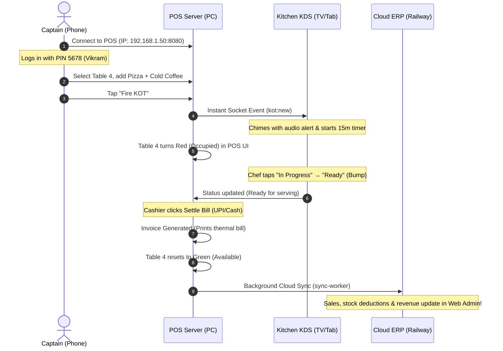

# 🚀 Gusto ERP — Railway Deployment Plan & Client Testing Packages

This document outlines the **end-to-end plan for deploying Gusto ERP services to Railway for dry-run testing**, as well as the **client-ready distribution packages** for POS, KDS, and Captain App.

---

## 🏗️ 1. Architecture Overview (Dry-Run Topology)

```
                          ┌────────────────────────────────┐
                          │         RAILWAY CLOUD          │
                          │                                │
                          │  ┌──────────┐    ┌──────────┐  │
                          │  │PostgresSQL│   │  Redis   │  │
                          │  └────┬─────┘    └────┬─────┘  │
                          │       │               │        │
                          │  ┌────┴───────────────┴─────┐  │
                          │  │       api-gateway        │  │
                          │  │  (Fastify + Cloud Sockets)│ │
                          │  └────────────┬─────────────┘  │
                          │               │                │
                          │  ┌────────────┴─────────────┐  │
                          │  │       sync-worker        │  │
                          │  │  (BullMQ + Deductions)   │  │
                          │  └──────────────────────────┘  │
                          │               │                │
                          │  ┌────────────┴─────────────┐  │
                          │  │        web-admin         │  │
                          │  │  (Next.js ERP Dashboard) │  │
                          │  └──────────────────────────┘  │
                          └────────────────────────────────┘
                                          ▲
                                          │ Cloud Sync (REST/WS)
              ┌───────────────────────────┴───────────────────────────┐
              │                                                       │
 ┌─────────────────────────┐                             ┌─────────────────────────┐
 │   CLIENT TESTING PC     │                             │   STAFF MOBILE & TV     │
 │                         │                             │                         │
 │ ┌─────────────────────┐ │     Local LAN Wi-Fi /       │ ┌─────────────────────┐ │
 │ │  pos-local-server   │◄├────────── WebSocket ───────►│ │    app-captain      │ │
 │ │  (Express + SQLite) │ │                             │ │ (Android APK/Expo)  │ │
 │ └──────────┬──────────┘ │                             │ └─────────────────────┘ │
 │            │            │                             │ ┌─────────────────────┐ │
 │ ┌──────────┴──────────┐ │                             │ │       kds-tv        │ │
 │ │       pos-ui        │ │                             │ │ (Android TV/Browser)│ │
 │ │(Touch Billing Screen│ │                             │ └─────────────────────┘ │
 │ └─────────────────────┘ │                             └─────────────────────────┘
 └─────────────────────────┘
```

---

## ☁️ 2. Railway Deployment Step-by-Step

Railway allows deploying from your monorepo GitHub repository with Dockerfiles for each service.

### Step 2.1: Create Project & Add Managed Databases

1. Log in to [Railway.app](https://railway.app).
2. Click **"New Project"** → **"Empty Project"**.
3. Click **"Add Service"** → **"Database"** → **"Add PostgreSQL"**.
   - Railway will provision PostgreSQL and automatically create the `DATABASE_URL` variable.
4. Click **"Add Service"** → **"Database"** → **"Add Redis"**.
   - Railway will provision Redis and automatically create the `REDIS_URL` variable.

---

### Step 2.2: Deploy `api-gateway` (Cloud REST & WebSockets)

1. Click **"Create"** → **"GitHub Repo"** → Select your `Gustos` repository.
2. In the service settings, rename the service to `api-gateway`.
3. Configure **Build & Deploy**:
   - **Root Directory:** `/` (Keep at monorepo root)
   - **Dockerfile Path:** `apps/api-gateway/Dockerfile`
   - **Watch Paths:** `/apps/api-gateway/**`, `/packages/**`
4. Set **Variables**:
   | Variable | Value | Description |
   |---|---|---|
   | `DATABASE_URL` | `${{Postgres.DATABASE_URL}}` | Reference to Railway Postgres |
   | `REDIS_URL` | `${{Redis.REDIS_URL}}` | Reference to Railway Redis |
   | `JWT_SECRET` | `gusto_dry_run_super_secret_jwt_key_2026` | Random secure string |
   | `JWT_EXPIRY` | `7d` | Token lifetime |
   | `CORS_ORIGIN` | `*` | Or specify Web Admin domain |
   | `NODE_ENV` | `production` | Production mode |
5. In **Networking**, click **"Generate Domain"** (e.g., `api-gateway-production.up.railway.app`).
6. Set **Healthcheck Path:** `/health`.

---

### Step 2.3: Deploy `sync-worker` (Background Job & Webhook Processor)

1. Click **"Add Service"** → **"GitHub Repo"** → Select your `Gustos` repository.
2. Rename the service to `sync-worker`.
3. Configure **Build & Deploy**:
   - **Root Directory:** `/`
   - **Dockerfile Path:** `apps/sync-worker/Dockerfile`
   - **Watch Paths:** `/apps/sync-worker/**`, `/packages/**`
4. Set **Variables**:
   | Variable | Value | Description |
   |---|---|---|
   | `DATABASE_URL` | `${{Postgres.DATABASE_URL}}` | Shared cloud Postgres |
   | `REDIS_URL` | `${{Redis.REDIS_URL}}` | Shared BullMQ Redis |
   | `SYNC_WORKER_CONCURRENCY` | `5` | Number of concurrent jobs |
   | `NODE_ENV` | `production` | Production mode |
5. Networking: **No public domain needed** (Worker listens to Redis queues).

---

### Step 2.4: Deploy `web-admin` (Next.js Cloud ERP Dashboard)

1. Click **"Add Service"** → **"GitHub Repo"** → Select your `Gustos` repository.
2. Rename the service to `web-admin`.
3. Configure **Build & Deploy**:
   - **Root Directory:** `/`
   - **Dockerfile Path:** `apps/web-admin/Dockerfile`
   - **Watch Paths:** `/apps/web-admin/**`, `/packages/**`
4. Set **Variables & Build Args**:
   | Variable | Value |
   |---|---|
   | `NEXT_PUBLIC_API_URL` | `https://${{api-gateway.RAILWAY_PUBLIC_DOMAIN}}/api/v1` *(or paste the actual api-gateway URL)* |
   | `NODE_ENV` | `production` |
5. In **Networking**, click **"Generate Domain"** (e.g., `web-admin-production.up.railway.app`).
6. Healthcheck: `/login`.

---

### Step 2.5: Seed Cloud Database (One-time setup)

To initialize the cloud PostgreSQL database schema and insert default admin/franchise data:

Using the Railway CLI on your computer:
```bash
# Link your local terminal to the Railway project
railway link

# Push cloud Drizzle schema
railway run --service api-gateway pnpm --filter @gusto/db-schema db:push:cloud

# Seed organization, outlets, staff, and menu
railway run --service api-gateway pnpm --filter @gusto/api-gateway seed
```

---

## 📦 3. Client Testing Packages (Generated)

The distribution files have been compiled into:
📁 **`dist-packages/`**

| Package | Contents | Best For |
|---|---|---|
| **`gusto-pos-desktop.zip`** | Pre-seeded POS Server + Cashier UI + KDS UI + 1-click launchers (`start-pos.bat`, `start-pos.sh`) | Restaurant counter PC / Laptop testing |
| **`gusto-captain/`** | Instant Expo Go launcher (`start-expo-go.sh`), EAS APK builder (`build-apk.sh`), Client Guide | Android / iOS Captain Waiter ordering |
| **`gusto-kds/`** | Web distribution + Android TV setup guide | Smart TV / Android TV / Tablet kitchen display |

---

## 🎯 4. Dry Run Testing Flow with the Client

Here is how the end-to-end dry run should be demonstrated to the client:



---

## 🔑 5. Client Test Credentials

| App | Role | Identifier / Email | PIN / Password |
|---|---|---|---|
| **Web Admin ERP** | Super Admin | `manager@gusto.dev` | `Admin@123456` *(or seeded password)* |
| **POS Billing** | Cashier | Rahul Kumar | PIN: `1234` |
| **POS Billing** | Manager | Priya Sharma | PIN: `1234` |
| **Captain App** | Floor Captain | Vikram Singh | PIN: `5678` |
| **KDS Screen** | Kitchen | Direct URL access: `http://<pos-ip>:8080/kds` | No PIN needed |
